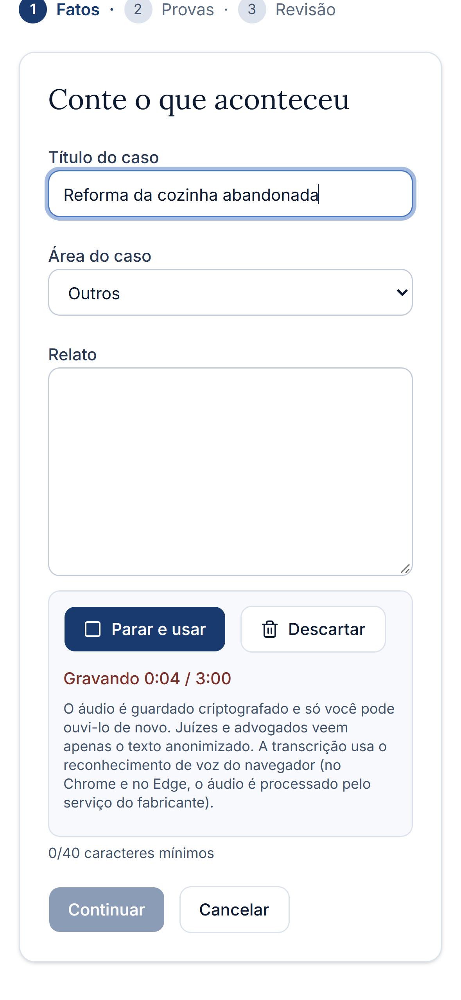
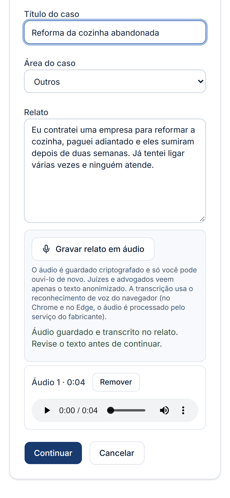
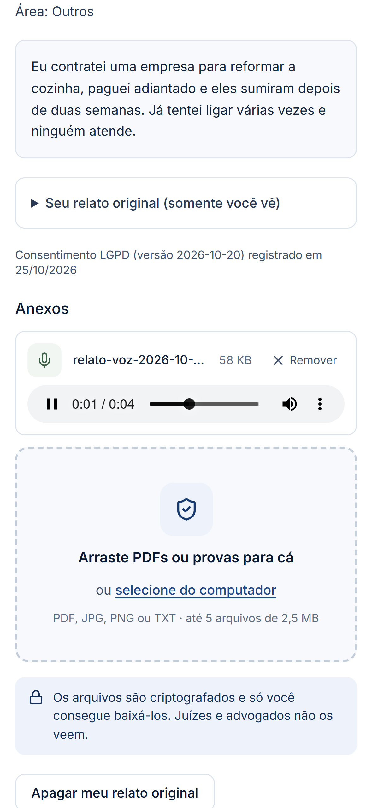
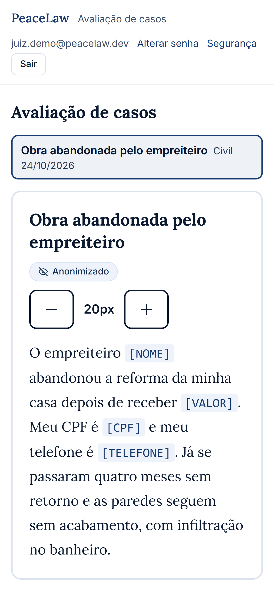
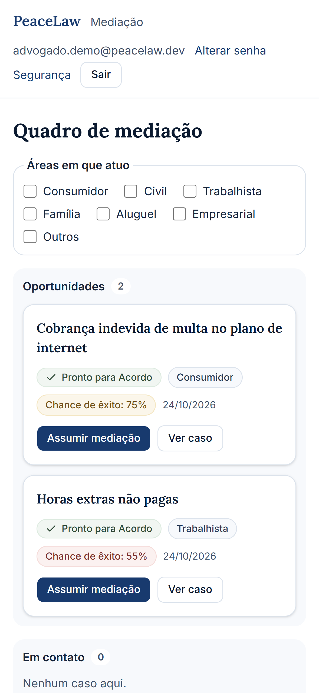
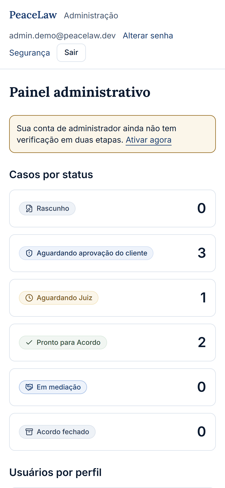

# PeaceLaw

Plataforma de **resolução online de disputas (ODR)** com anonimização de dados, análise de chance de êxito por juízes avaliadores e mediação por advogados. MVP desenvolvido para o processo seletivo; foco em **Privacy by Design** e conformidade com a LGPD.

> Resolva a disputa antes que ela vire processo.

## Como funciona

1. **Cliente** conta o caso (por texto ou por **áudio transcrito em português**), anexa provas e dá consentimento. O sistema anonimiza o relato (nomes, CPF, telefones, endereços, valores, datas de nascimento, IPs…) e o cliente **aprova a versão anonimizada** antes de qualquer outra pessoa ler.
2. **Juiz avaliador** vê apenas o texto anonimizado e dá notas para provas e jurisprudência. O sistema calcula a **chance de êxito**.
3. **Advogado mediador** vê os casos avaliados (priorizados pelas áreas em que atua), assume a mediação e, ao final, marca o acordo.
4. **Administrador** cria contas internas, desativa/reativa usuários, redefine senhas e acompanha números agregados e a trilha de auditoria.

| Ator | O que faz | O que **não** vê |
|---|---|---|
| Cliente | Cria casos, grava áudio, anexa provas, aprova o texto anonimizado, apaga o relato original | Dados de outros clientes |
| Juiz | Avalia casos anonimizados | Relato original, anexos, áudio, identidade do cliente |
| Advogado | Assume casos avaliados, conduz o acordo | Relato original, anexos, áudio |
| Admin | Gerencia contas e auditoria | Conteúdo dos casos |

## Relato por voz (destaque)

No passo "Fatos" o cliente grava um áudio (até 3 min). O navegador transcreve em **pt-BR** e o texto entra no relato (editável); o áudio aparece como um player, como uma mensagem de voz, e pode ser ouvido de novo na tela do caso. O áudio é guardado **criptografado**, só o dono ouve, e é apagado junto com o relato original. Detalhes e limites em [docs/voice-notes.md](docs/voice-notes.md).

## Mockups (iPhone)

Capturas do app rodando localmente em emulação de iPhone (393×852, @3x, Safari iOS) em [docs/mockups-ios/](docs/mockups-ios/): telas públicas, cliente, **fluxo do microfone e da transcrição**, juiz, advogado e admin. A transcrição nas capturas foi simulada (o Chrome sem serviço de voz não transcreve em ambiente automatizado) e a emulação não é o Safari real.

| Gravando | Áudio + transcrição | Ouvir de novo |
|---|---|---|
|  |  |  |

| Juiz (texto anonimizado) | Advogado | Admin |
|---|---|---|
|  |  |  |

## Contas de teste para avaliadores

Contas **públicas, só para demonstração**, com dados fictícios. Elas existem em um banco descartável, separado de qualquer dado real; não use dados pessoais reais.

| Ator | E-mail | Senha |
|---|---|---|
| Cliente | `cliente.avaliador@peacelaw.dev` | `cliente-avaliador-2026` |
| Juiz | `juiz.avaliador@peacelaw.dev` | `juiz-avaliador-2026` |
| Advogado | `advogado.avaliador@peacelaw.dev` | `advogado-avaliador-2026` |
| Administrador | `admin.avaliador@peacelaw.dev` | `admin-avaliador-azul-2026` |

- **Demonstração online:** https://peacelaw-demo.vercel.app (ambiente de demonstração isolado: banco próprio e dados fictícios). Se a página pedir login do Vercel, a proteção de implantação ainda está ligada; use a execução local abaixo.
- **Local:** `python -m scripts.seed_evaluator_accounts --public-demo` (em `backend/`) cria as mesmas quatro contas e três casos de exemplo no banco local. O script **recusa rodar** sem a opção `--public-demo` e em qualquer banco que tenha outras contas, para nunca ser apontado a dados reais.
- Um caminho sugerido: entre como **cliente**, grave um áudio no passo "Fatos" (Chrome/Edge, com microfone), aprove o texto anonimizado; depois como **juiz**, avalie o caso; como **advogado**, assuma a mediação; como **administrador**, veja o painel e o kit de pitch em `/admin/pitch`. A conta de administrador de demonstração permite testar o 2FA em `/conta/seguranca`.

## Arquitetura

- **Frontend:** Next.js 16 (Cache Components), React 19, Tailwind v4, componentes shadcn/ui, Vitest.
- **Backend:** FastAPI, SQLAlchemy 2, Alembic, Pydantic 2, Argon2id.
- **Banco:** PostgreSQL (Neon); SQLite nos testes.
- **Hospedagem:** Vercel (um projeto, dois serviços: frontend e API em `/api`).

```
frontend/   Next.js (telas por ator, anonimização exibida, gravador de voz)
backend/    FastAPI (app/routers, app/privacy, app/security), migrações Alembic, testes
docs/       PRD, specs, guias (deploy, backup, monitoramento, voz), avaliação de segurança, mockups
```

## Privacidade e segurança

- Relato original e anexos **criptografados em repouso** (Fernet, chaves rotacionáveis); texto anonimizado separado.
- **Anonimização por regras** antes de qualquer terceiro ler, com aprovação do cliente; apagamento a pedido e por prazo (180 dias).
- Sessões por cookie httpOnly revogável, Argon2id, política de senhas, limite de tentativas compartilhado (banco), **2FA TOTP** com códigos de recuperação, confirmação de senha para ações sensíveis de administradores, trilha de auditoria só com ids.
- Cabeçalhos de segurança, CSP, proteção contra requisições de outro site, limites de corpo e validação de uploads por assinatura.
- Uma bateria de **39 ataques automatizados** roda como teste de regressão. Resultado e pendências em [docs/security-assessment.md](docs/security-assessment.md).

## Rodando localmente

Requisitos: Python 3.13, Node 20+.

```bash
# Backend (SQLite local, sem segredos reais)
cd backend
python -m venv .venv && .venv/Scripts/python -m pip install -r requirements.txt   # Linux/macOS: .venv/bin/python
export DATABASE_URL="sqlite+pysqlite:///./local.db"
export JWT_SECRET="$(python -c 'import secrets;print(secrets.token_urlsafe(48))')"
export RAW_TEXT_KEYS="$(python -c 'from cryptography.fernet import Fernet;print(Fernet.generate_key().decode())')"
export COOKIE_SECURE=false CORS_ORIGINS=http://localhost:3000
python -c "import app.models; from app.db import Base, get_engine; Base.metadata.create_all(get_engine())"
python -m scripts.seed_evaluator_accounts --public-demo   # cria as contas de teste acima e casos de exemplo
python -m uvicorn main:app --port 8000

# Frontend (em outro terminal)
cd frontend
npm install
BACKEND_URL=http://127.0.0.1:8000 npm run dev      # http://localhost:3000
```

Para criar um administrador: `python -m scripts.create_user --email admin@exemplo.com --role ADMIN`.
Com PostgreSQL, use `alembic upgrade head` em vez do `create_all`.

## Testes

```bash
cd backend  && python -m pytest -q        # 597 testes (inclui a bateria de ataques)
cd frontend && npx vitest run             # 318 testes
```

O CI (`.github/workflows/ci.yml`) roda os dois conjuntos e a auditoria de dependências (`pip-audit`).

## Documentação

[PRD](docs/prd.md) · [Avaliação de segurança](docs/security-assessment.md) · [Voz](docs/voice-notes.md) · [Deploy](docs/deploy.md) · [Backup](docs/backup.md) · [Monitoramento](docs/monitoring.md) · [Design system](docs/design-system/) · [Especificações e planos](docs/superpowers/)

Os workflows de operação (uptime, backup diário e retenção LGPD) dependem de segredos e rodam no repositório privado; aqui ficam apenas os scripts e a documentação.

## Limitações conhecidas

- A anonimização é por regras: nomes sem nenhuma pista no texto e cidades soltas podem passar (por isso o cliente aprova o texto antes). O próximo passo previsto é uma camada de reconhecimento de nomes.
- A transcrição de voz usa o reconhecimento do navegador (no Chrome/Edge o áudio é processado pelo serviço do fabricante); Firefox não transcreve.
- O texto de consentimento e a política de privacidade são **rascunhos** que dependem de revisão jurídica.
- O casamento com advogados é por regra simples de área (sem IA); não há pagamentos nem homologação de câmara de arbitragem (fora do escopo do MVP).
- A demonstração publicada na Vercel fica atrás de proteção de implantação até o lançamento (sem domínio próprio ainda).

## Processo de desenvolvimento

O projeto foi construído com apoio de IA (Claude Code), com especificação, planos e revisão por etapa registrados em `docs/superpowers/`. As decisões de escopo, o texto jurídico e a aprovação final são do autor.
